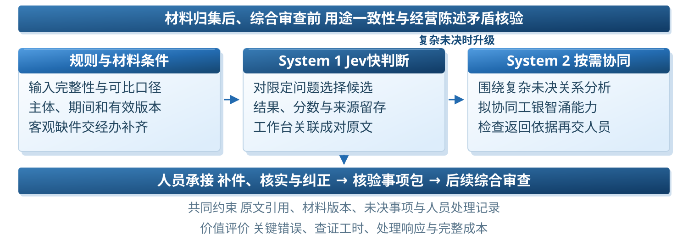

# 工银智涌 e贷

**基于Jev式判断与快慢协同的贷前材料核验引擎**

本项目面向数字金融赛道，聚焦材料归集后、综合审查前的资金用途一致性与经营陈述矛盾核验。通过规则检查、结构化判断、按需复杂分析和人工复核，将核验建议与材料证据、版本和责任记录连续交接。



## 从方法论与产品设计开始

| 文档 | 说明 |
| --- | --- |
| [方法论](docs/METHODOLOGY.md) | 业务任务定义、为什么采用Jev式判断、快慢分工与增量验证 |
| [产品设计](docs/PRODUCT_DESIGN.md) | 使用者、介入位置、补件复核闭环与工小审拟议交接 |
| [计划书材料说明](docs/plan/) | 计划书不随公开代码仓库分发 |
| [蓝色科研图表](docs/FIGURES.md) | 可编辑SVG、300DPI PNG和Word内嵌媒体 |
| [验证记录](docs/VALIDATION.md) | 当前真实结果、负结果与待验证条件 |
| [运行与部署](docs/DEPLOYMENT.md) | 本地流程、云端演示、官方Jev、社区模型及检查命令 |
| [参考来源](docs/REFERENCES.md) | 官方文档、社区参考及银行公开来源 |

## 核心设计

限定判断任务适配Jev式结构化输出；复杂问题保留分析入口，由人员确认后协同处理，并通过证据及办理记录承接。当前未启用自动升级。判断服务可以更换，业务任务与材料版本保持。核验完成不等同于贷款批准。

首期关注三项业务变化：成对原文可回看，补件后按新版本重跑，待处理事项带着证据和人员意见交给后续审查。相对工小审现有能力的新增必要性，需要同任务比较确认。

## 当前验证状态

截至2026年10月24日，云端判断后端采用蚂蚁数科LingDT-Decision-1.0，Jev式判断为结构化候选判断的方法称呼，未训练或微调基础权重。24项新编合成评价任务中，判断服务参考一致19/24，生成式分析17/24；分项为用途11/12与8/12、经营8/12与9/12。36项合成开发任务的平均接口响应分别为生成式分析1009.394毫秒、判断服务308.841毫秒、生成式判断723.418毫秒。开发任务与新编评价分别统计，费用尚未核实。

历史TypeSafe官方Jev两例协议连接、社区54份开发资料及28份挑战仍分别归档，不能与当前LingDT结果混用。参考标签尚未经独立业务复核，未形成银行人员工时、审批提速或完整成本收益实测。

软件流程与模型效果分别记录。完整成本、复核工时与工小审增量的采集模板位于[评审补证材料](docs/evidence-templates/)。

## 本地运行

Python 3.10及以上可运行不依赖模型的流程演示：

```powershell
python -X utf8 demo/app.py --mode simulation --port 8765
```

本地打开 http://127.0.0.1:8765/ 。当前已部署云端演示入口：普通流程为 http://123.207.241.109/ ，产品核验工作台为 http://123.207.241.109:8772/ 。工作台当前调用LingDT判断服务，保留可替换适配层；原产品网址和二维码入口保持不变。云端仅用于竞赛演示与受控仿真，不是工商银行生产系统。

## 仓库内容

```text
docs/               方法论、产品设计、图表与补证材料
demo/               工作台、任务规范、判断后端、证据与留痕
评审整改/           保留原路径的领域实验、官方协议与白名单记录
scripts/            跨机器启动和发布包完整性检查
release-manifest.json 文件清单、来源hash与实验状态
```

模型权重、运行数据库、凭据和历史聊天记忆不进入仓库。实验原始输入、参考标签及冻结代码按原路径保留，避免改变协议中的来源hash。第三方代码许可见[技术来源与许可](THIRD_PARTY_NOTICES.md)。

这是独立竞赛研究原型，工行生态关系为拟议适配，不代表工商银行官方系统或生产接入。

